<div align="center">

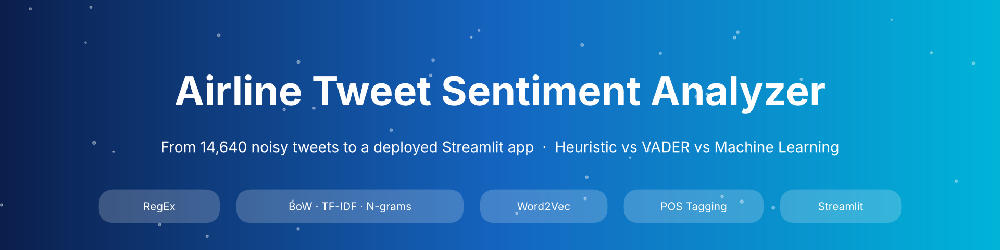

# ✈️ Airline Tweet Sentiment Analyzer

**NLP Practical Report 1 (PR 1) · Red & White Skill Education**

### 🚀 **LIVE APP → [YOUR_STREAMLIT_URL](YOUR_STREAMLIT_URL)**

[](YOUR_STREAMLIT_URL)
[](YOUR_VIDEO_LINK)
[](https://www.kaggle.com/datasets/crowdflower/twitter-airline-sentiment)


**[📓 Notebook](NLP_PR1.ipynb)** ·
**[🌐 HTML Export](NLP_PR1.html)** ·
**[🧠 App](app.py)** ·
**[🧰 nlp_utils.py](nlp_utils.py)** ·
**[🎥 Video](YOUR_VIDEO_LINK)**

</div>

---

## 📑 Table of Contents

[Overview](#-overview) · [Live Demo](#-live-demo--app-plots) · [Dataset](#-dataset) · [Pipeline](#-pipeline-summary) · [Results](#-results-comparison) · [Topics Explained](#-topics-used--explained) · [Analysis Gallery](#-analysis-gallery) · [Structure](#-repository-structure) · [Run Locally](#-how-to-run-locally) · [Video](#-video) · [Tools & Versions](#-tools--versions) · [What I Learned](#-what-i-learned) · [Author](#-author)

---

## 🎯 Overview

Airline tweets are exactly the kind of text that makes NLP hard: **@mentions, URLs, hashtags, emojis, slang, sarcasm and negation** (*"not happy"*, *"never again"*). This project takes **14,640 real tweets** and walks the full NLP path:

> **raw tweet → RegEx cleaning → tokens → features → model → evaluation → deployed Streamlit app**

Three NLP approaches are built and **measured on the same stratified test set**:

| Approach | Idea | Needs labels? |
|---|---|:---:|
| 🧩 **Heuristic** | Own airline-specific lexicon (36 positive / 40 negative words) with negation flipping | No |
| ☁️ **API-style** | NLTK **VADER** compound score, no training | No |
| 🤖 **Machine Learning** | BoW / TF-IDF / N-grams / Word2Vec + Logistic Regression | Yes |

**Headline result:** TF-IDF (1,2)-grams + Logistic Regression reaches **macro-F1 0.753** (accuracy 0.800), far ahead of VADER (0.515) and the heuristic (0.572).

---

## 🖥️ Live Demo & App plots

> 🔗 **Live URL:** [YOUR_STREAMLIT_URL](YOUR_STREAMLIT_URL)

The app lets you type a tweet, choose an approach (**Heuristic / VADER / ML model**) and press **Predict**.

| 1 · Start screen | 2 · Positive prediction |
|:---:|:---:|
|  |  |
| *Examples in the sidebar, approach selector, text area* | *Positive tweet scored by the ML model* |

| 3 · Negative prediction | 4 · Probability chart |
|:---:|:---:|
|  |  |
| *Negation + complaint → negative* | *Class probabilities from `predict_proba`* |

<div align="center">

| 5 · POS-tag expander |
|:---:|
|  |
| *Part-of-speech tags of the entered tweet via NLTK* |

</div>

**App features**

- ✅ Approach selector: Heuristic · VADER · ML model (TF-IDF + Logistic Regression)
- ✅ 3 example buttons (positive, negative, neutral), cached model loading with `@st.cache_resource`
- ✅ Shows the **cleaned text**, a coloured prediction card and a **probability bar chart**
- ✅ Collapsible **POS-tag** expander (NLTK)
- ✅ Robust inputs: empty, very long (cut at 500 characters), emoji-only and URL-only text never crash the app (9 inputs tested)
- ✅ NLTK data downloaded safely at start-up; `nlp_utils.py` is shared by notebook and app so both behave identically

---

## 📊 Dataset

| | |
|---|---|
| **Name** | Twitter US Airline Sentiment |
| **Source** | [Kaggle – CrowdFlower / Figure Eight](https://www.kaggle.com/datasets/crowdflower/twitter-airline-sentiment) |
| **Raw size** | 14,640 tweets × 15 columns |
| **After removing 213 duplicates** | **14,427 tweets** |
| **Columns used** | `text` (input) · `airline_sentiment` (target) · `airline` (EDA only) |
| **Split** | 80 / 20 stratified, `random_state=42` → 11,541 train / 2,886 test (split *before* any vectoriser or Word2Vec fit) |
| **Imbalance** | ≈ 63 % negative · 21 % neutral · 16 % positive → **macro-F1** is the main metric |

> The raw `Tweets.csv` is not stored in this repository. Download it from the Kaggle page above and place it next to the notebook.

---

## 🧭 Pipeline Summary

<div align="center">
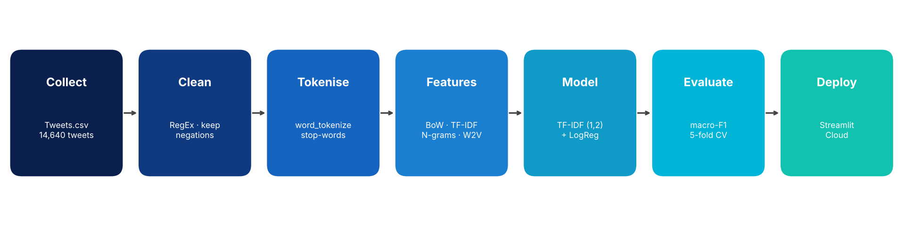
</div>

| # | Task | What was done |
|:---:|---|---|
| **1** | NLP fundamentals & EDA | Theory, task/approach tables, pipeline map, de-duplication, 3 EDA plots, 5 real tweets showing NLP challenges |
| **2** | RegEx cleaning & tokenisation | Tested patterns, `clean_text()` (URLs, @mentions, hashtags, contractions, numbers, punctuation), negation words kept in the stop-word set, vocabulary 26,840 → 11,162 |
| **3** | Heuristic vs API-based | Own lexicon with negation flip vs VADER, both on the same test set |
| **4** | BoW, TF-IDF, N-grams | Manual and sklearn versions matched, TF-IDF formula proved, n-gram and feature-size experiments |
| **5** | Word2Vec | CBoW and Skip-gram (`vector_size=100`, `window=5`, `min_count=3`, `epochs=20`, `seed=42`), similar words, PCA, document vectors |
| **6** | Classification & comparison | Pipelines, 6 feature/classifier combinations, 5-fold CV, error analysis, model saved with joblib |
| **7** | POS tagging | How taggers work, tagged tweets, POS distribution by sentiment, POS-filtered features |
| **8** | Streamlit app | `app.py`, robustness tests, `requirements.txt`, deployment |

---

## 🏆 Results Comparison

### All three approaches in one table (same 2,886 test tweets)

| Approach | Method | Accuracy | Macro-F1 |
|---|---|:---:|:---:|
| 🧩 Heuristic | Own airline lexicon + negation | 0.559 | 0.572 |
| ☁️ API-based | VADER (compound ≥ 0.05 / ≤ −0.05) | 0.549 | 0.515 |
| 🤖 BoW | BoW + Logistic Regression | 0.768 | 0.725 |
| 🤖 TF-IDF | TF-IDF unigrams + Logistic Regression | 0.774 | 0.732 |
| 🥇 **N-gram** | **TF-IDF (1,2) + Logistic Regression** | **0.800** | **0.753** |
| 🤖 Word2Vec | CBoW averaged vectors + Logistic Regression | 0.701 | 0.657 |

<div align="center">
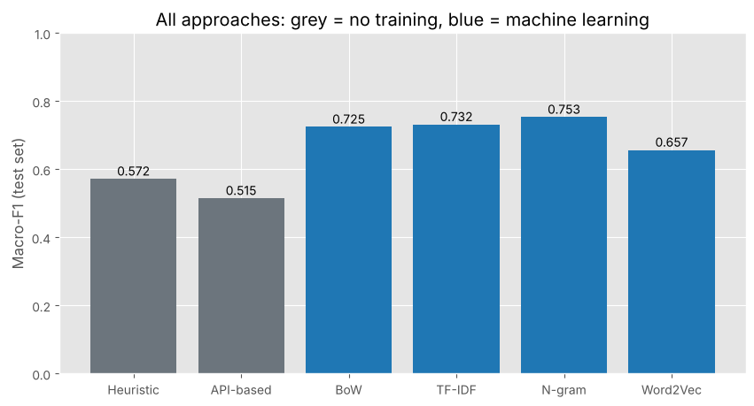
</div>

### Feature / classifier combinations (Tasks 6.3 and 7.5)

| | Features | Classifier | Accuracy | Macro-F1 | Precision (neg) | Recall (pos) | Train time (s) |
|:---:|---|---|:---:|:---:|:---:|:---:|:---:|
| a | Bag-of-Words | Multinomial NB | 0.7699 | 0.6709 | 0.7798 | 0.5852 | 0.24 |
| b | Bag-of-Words | Logistic Regression | 0.7678 | 0.7247 | 0.8955 | 0.7598 | 0.76 |
| c | TF-IDF unigrams | Logistic Regression | 0.7741 | 0.7319 | 0.8881 | 0.7686 | 0.43 |
| **d** | **TF-IDF unigrams + bigrams** | **Logistic Regression** | **0.7997** | **0.7534** | 0.8925 | 0.7555 | 0.80 |
| e | Word2Vec (CBoW, averaged) | Logistic Regression | 0.7013 | 0.6569 | 0.8780 | 0.7293 | 3.91 |
| f | TF-IDF unigrams + bigrams | Linear SVM | 0.8035 | 0.7456 | 0.8624 | 0.7140 | 0.64 |
| g | POS-filtered (JJ/RB/VB + negations) | Logistic Regression | 0.7003 | 0.6377 | 0.8705 | 0.6070 | 0.42 |

### Key findings

- 🥇 **Best model:** TF-IDF (1,2) + Logistic Regression, **macro-F1 0.753**; deployed as the ML option in the app.
- ✅ **5-fold CV on training data:** 0.736 ± 0.006 vs test 0.753, so the model is stable and not overfitted.
- 🧩 The heuristic beat VADER because its word list is airline-specific (*cancelled, hold, hours, rude*); VADER does not treat these as negative.
- ⚖️ `class_weight='balanced'` lifted macro-F1 from **0.724 → 0.753** by improving recall on neutral and positive tweets.
- ✂️ **POS filtering hurt** (0.753 → 0.638): removing nouns such as *hold, luggage, service* deletes the strongest complaint clues.
- ❗ About **80 % of the 578 test errors involve the neutral class**; sarcasm and very short tweets stay hard.

---

## 📚 Topics Used & Explained

<details>
<summary><b>🔤 RegEx text cleaning</b></summary>

`clean_text()` runs in a deliberate order: lowercase → decode HTML entities → remove URLs → remove @mentions → keep hashtag word → **expand negative contractions** (`didn't` → `did not`) → remove numbers → remove punctuation/emoji → collapse spaces.

| Pattern | Meaning | Example |
|---|---|---|
| `https?://\S+` | `http`, optional `s`, `://`, then non-space characters | `https://t.co/abc` |
| `@\w+` | `@` followed by word characters | `@united` |
| `#(\w+)` → `\1` | keep the captured word, drop `#` | `#delayed` → `delayed` |
| `\d+` | one or more digits | `2500` |
| `[^a-z\s]` | anything that is not a letter or space | `!!!`, `:)`, emoji |
| `\s+` | repeated whitespace | `a    b` → `a b` |

Negation words (`no`, `not`, `nor`, `never`) are **kept** in the stop-word set: *"I am not happy with the delay"* would otherwise become `happy delay`.
</details>

<details>
<summary><b>🧩 Heuristic vs ☁️ API-based vs 🤖 ML</b></summary>

- **Heuristic:** hand-written positive/negative word lists; score = positives − negatives; a word flips polarity if *not/no/never* appears in the previous two words. Fast and explainable, but blind to sarcasm and unseen words.
- **API-based:** VADER returns a compound score in [−1, +1] with no training. Cloud services (Google Cloud NL, AWS Comprehend, Azure Text Analytics) work the same way but need an account, key and billing.
- **ML:** learns weights from labelled airline tweets, so it knows domain words and phrases.
</details>

<details>
<summary><b>🔢 Bag-of-Words, TF-IDF and N-grams</b></summary>

- **BoW** counts words; word order is lost, so *"good, not bad"* and *"bad, not good"* get identical vectors.
- **TF-IDF** weights `tf × (ln(N/df) + 1)`; words that appear in every document get a low weight. Verified by hand against `TfidfVectorizer(smooth_idf=False, norm=None)`. The default differs through **smoothing** and **L2 normalisation**.
- **N-grams** keep short phrases (`on hold`, `can not`, `thank you`). Vocabulary grows from **9,948 → 85,118 → 211,569** for (1,1), (1,2), (1,3).
- Vectorisers are fitted on **training data only** to prevent leakage.
</details>

<details>
<summary><b>🧬 Word2Vec — CBoW vs Skip-gram</b></summary>

- **CBoW:** context words → centre word (faster, good for frequent words).
- **Skip-gram:** centre word → context words (slower, better for rare words).
- Trained on the training tweets only (vocabulary of 3,683 words). Neighbours are sensible for CBoW (*delayed → late, delay, missed*; *thanks → thx, thank, appreciate*), but the corpus is small, so vectors are noisier than large-corpus ones. Averaging word vectors loses order and negation, which explains the lower F1 (0.657).
</details>

<details>
<summary><b>🏷️ POS tagging</b></summary>

NLTK's `pos_tag` uses a trained **averaged-perceptron** model. Context decides the tag (*park* is `VB` in "Please park the car" and `NN` in "in the park"). It was trained on news text, so informal tweets cause errors (e.g. an airline name tagged as an adjective). Positive tweets contain a larger share of adjectives (10.9 % vs 7.5 % in negative).
</details>

---

## 🖼️ Analysis Gallery

<details open>
<summary><b>Task 1 — Exploratory data analysis</b></summary>
<br>

| Sentiment distribution | Sentiment by airline |
|:---:|:---:|
| 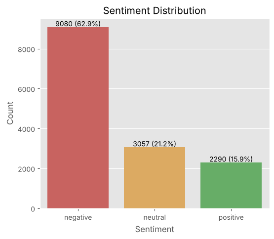 | 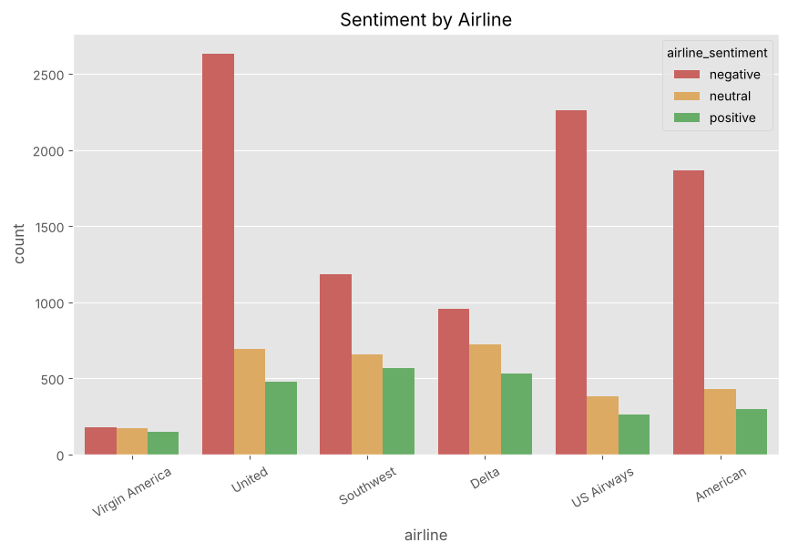 |

<div align="center">
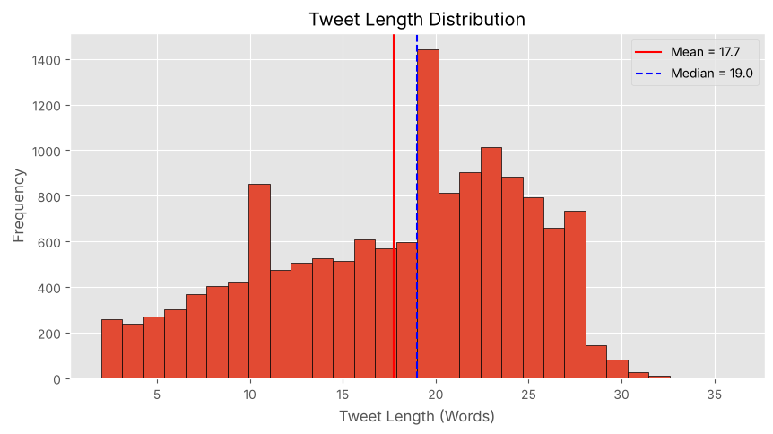
</div>

</details>

<details open>
<summary><b>Task 2 — Vocabulary statistics</b></summary>
<br>

| Top 20 words | Negative vs positive words |
|:---:|:---:|
| 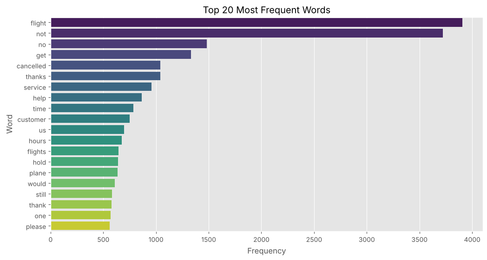 | 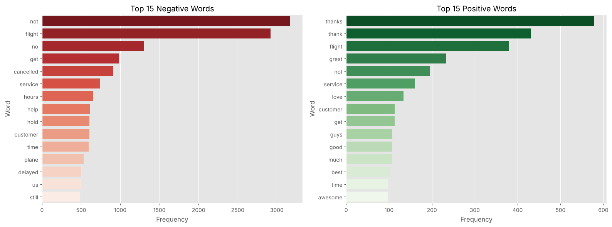 |

</details>

<details open>
<summary><b>Tasks 3 – 4 — Approaches and features</b></summary>
<br>

| Heuristic vs VADER confusion matrices | Feature-size experiment |
|:---:|:---:|
| 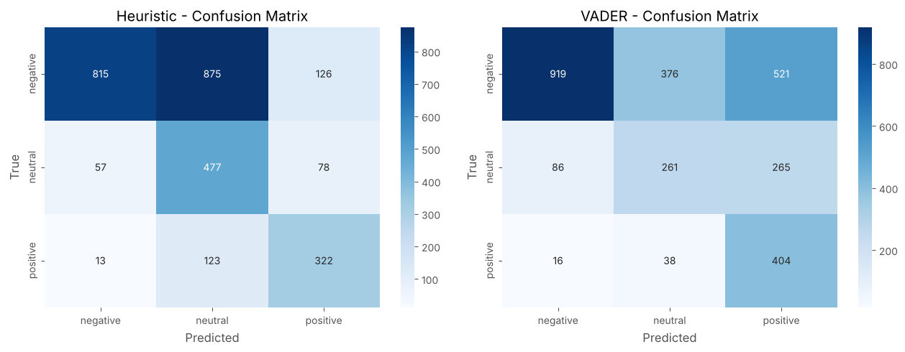 | 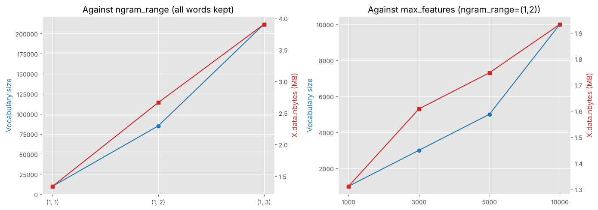 |

</details>

<details open>
<summary><b>Tasks 5 – 6 — Word2Vec and the baseline model</b></summary>
<br>

| Word2Vec PCA (60 words) | Baseline confusion matrix |
|:---:|:---:|
| 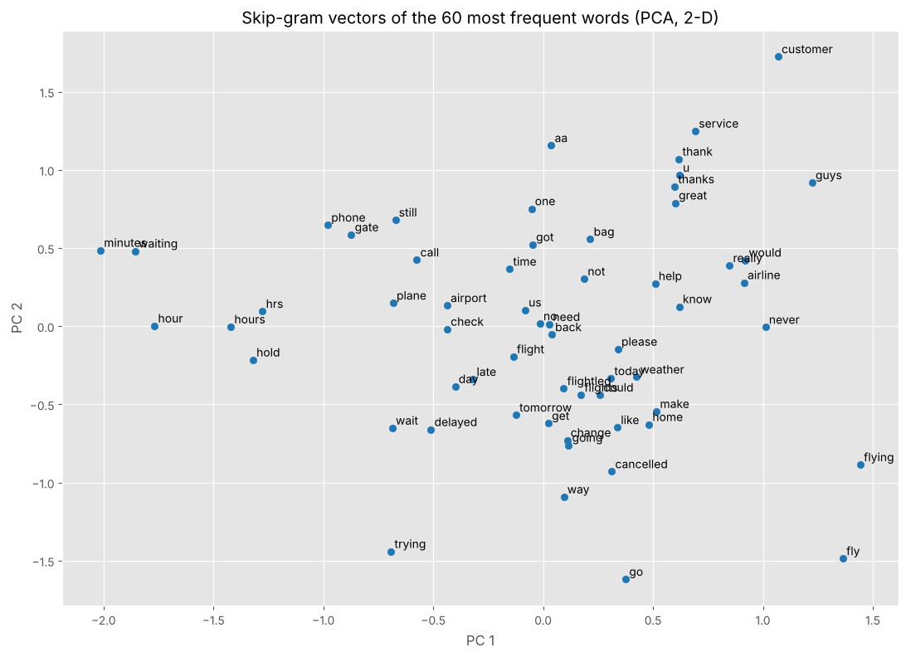 | 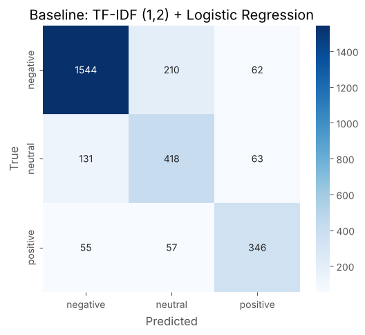 |

</details>

<details open>
<summary><b>Task 7 — POS distribution by sentiment</b></summary>
<br>

<div align="center">
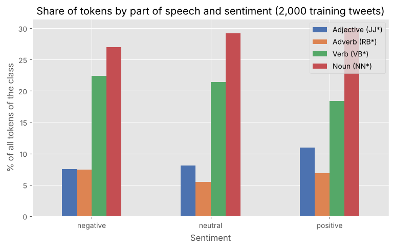
</div>

</details>

---

## 🗂️ Repository Structure

```text
airline-tweet-sentiment/
├── 📓 NLP_PR1.ipynb            # Tasks 1–7 + Task 8 notes (Restart & Run All)
├── 🌐 NLP_PR1.html             # HTML export of the executed notebook
├── 🚀 app.py                   # Streamlit app
├── 🧰 nlp_utils.py             # clean_text + heuristic lexicon (shared by notebook and app)
├── 🧠 sentiment_model.joblib   # TF-IDF (1,2) + Logistic Regression pipeline
├── 📦 requirements.txt         # Pinned versions
├── 📖 README.md
└── 🖼️ plots/             # App plots + analysis plots
```

---

## ⚙️ How to Run Locally

```bash
# 1. Clone
git clone https://github.com/YOUR_USERNAME/YOUR_REPO.git
cd YOUR_REPO

# 2. (Optional) virtual environment
python -m venv venv
source venv/bin/activate          # Windows: venv\Scripts\activate

# 3. Install the app dependencies
pip install -r requirements.txt

# 4. Start the app
streamlit run app.py              # opens http://localhost:8501
```

**To re-run the notebook** you also need `matplotlib`, `seaborn` and `gensim`, plus `Tweets.csv` from [Kaggle](https://www.kaggle.com/datasets/crowdflower/twitter-airline-sentiment):

```bash
pip install matplotlib seaborn gensim jupyter
jupyter notebook NLP_PR1.ipynb
```

> ⚠️ **Version warning:** `sentiment_model.joblib` was trained with **scikit-learn 1.9.1**. Use the same version, otherwise loading the model may fail.
> If NLTK reports a missing resource, download exactly the name shown in the error (e.g. `punkt_tab`, `averaged_perceptron_tagger_eng`).

---

## 🎥 Video

[](YOUR_VIDEO_LINK)

> `NLP_PR1_YourName_GRID.mp4` · 5–10 min · face (picture-in-picture) + screen · covers all 8 tasks and a **live test of the deployed app** with new inputs including a negation example.

---

## 🛠️ Tools & Versions

| Library | Version |
|---|---|
| Streamlit | 1.66.1 |
| scikit-learn | 1.9.1 |
| NLTK | 3.10.4 |
| pandas | 3.0.6 |
| numpy | 2.5.4 |
| joblib | 1.6.0 |
| gensim · matplotlib · seaborn | notebook only (not needed by the app) |

---

## 💡 What I Learned

- **Biggest effect:** using labelled domain data at all (macro-F1 0.52–0.57 → 0.73–0.75), then the negation-keeping cleaning rule and bigram features.
- **Deployed:** TF-IDF (1,2) + Logistic Regression: best macro-F1, gives probabilities, trains in about a second and is easy to explain. Heuristic and VADER stay selectable for comparison.
- **Weakness:** the neutral class is confused with the others, sarcasm (*"awesome service… NOT"*) fools the model and emojis are removed by cleaning.
- **Next step beyond this practical:** a Transformer such as BERT for context-aware sentiment *(named only, not implemented)*.

---

## 👤 Author

**YOUR NAME** · GRID: `YOUR_GRID`
NLP Practical Report 1 · Red & White Skill Education

[](https://github.com/YOUR_USERNAME)

<div align="center">

*Dataset: Twitter US Airline Sentiment, originally published by CrowdFlower (Figure Eight), via [Kaggle](https://www.kaggle.com/datasets/crowdflower/twitter-airline-sentiment).*

*"Shaping Skills for Scaling Higher"* ⭐

</div>
